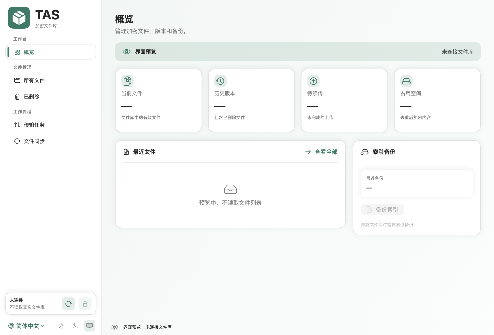
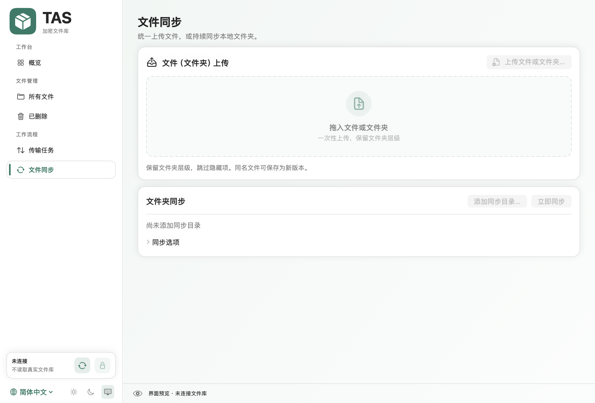
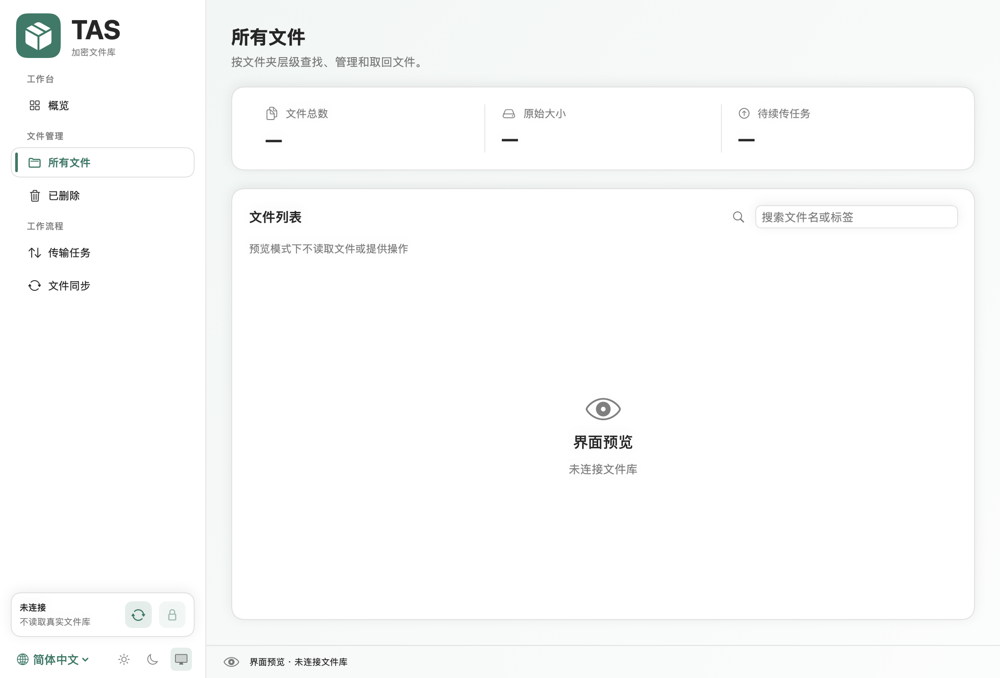
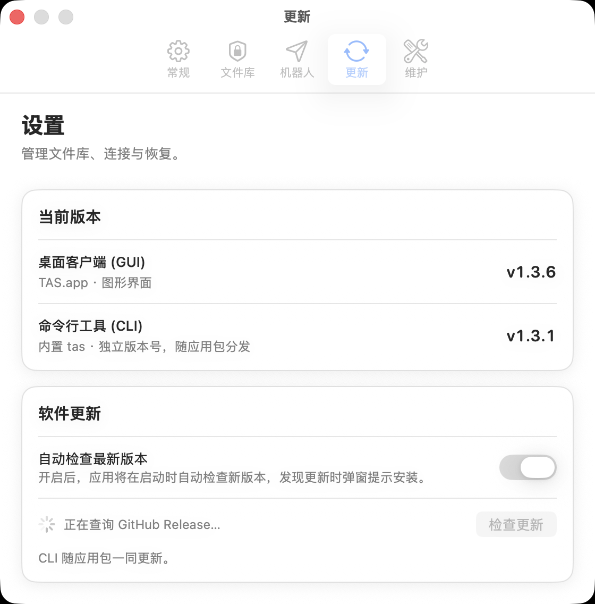

# TAS for Mac：专为 macOS 打造的 Telegram 原生端到端加密云盘

> **释放 Telegram 无限存储潜力，拥抱纯粹的原生 macOS 桌面体验。**

---

## 目录
1. [设计哲学：原生、轻盈、私密](#1-设计哲学原生轻盈私密)
2. [工作台与文件管理架构](#2-工作台与文件管理架构)
   - [概览工作台（Dashboard）](#21-概览工作台dashboard)
   - [文件同步与拖拽中心（Sync & Upload）](#22-文件同步与拖拽中心sync--upload)
   - [层次化文件列表与版本回溯（File Management）](#23-层次化文件列表与版本回溯file-management)
3. [macOS 深度系统级集成](#3-macos-深度系统级集成)
   - [原生设置体系（Settings · ⌘,）](#31-原生设置体系settings--)
   - [屏幕菜单栏与常驻状态栏（MenuBarExtra）](#32-屏幕菜单栏与常驻状态栏menubarextra)
   - [启动与后台策略](#33-启动与后台策略)
4. [硬核安全与存储引擎](#4-硬核安全与存储引擎)
   - [本地端到端加密与代际密码旋转](#41-本地端到端加密与代际密码旋转)
   - [分块流式传输与 Telegram 多 Bot 负载](#42-分块流式传输与-telegram-多-bot-负载)
   - [加密远端索引与灾难恢复](#43-加密远端索引与灾难恢复)
5. [命令行协作（tas CLI）](#5-命令行协作tas-cli)
6. [快速开始](#6-快速开始)

---

## 1. 设计哲学：原生、轻盈、私密

云盘服务的痛点长期困扰着现代知识工作者与开发者：高昂的订阅费用、恼人的限速、苛刻的内容审查，以及 Electron 客户端动辄吞噬数以百兆内存与 CPU 资源的臃肿架构。

**TAS（Telegram as Storage）for Mac** 应运而生。它不是网页打包的玩具，而是一款用 **Swift + SwiftUI** 从底层完整构建的现代化 macOS 原生应用。

- **零膨胀**：没有 Node.js、Electron、Chromium 或 WebView 依赖，冷启动与内存占用轻如鸿毛。
- **真原生**：严格遵循 **Apple Human Interface Guidelines (HIG)**，完美契合 macOS 视觉规范，窗口拖拽、深浅模式自适应与键盘交互如同系统内置工具。
- **无限与私密**：将 Telegram 的无限文件托管转化为完全属于你的加密个人网盘，所有数据在离开你的 Mac 前已完成高强度本地加密。

---

## 2. 工作台与文件管理架构

### 2.1 概览工作台（Dashboard）

首次解锁文件库后，呈现的是优雅的信息仪表盘。界面以自适应的卡片形式实时反映文件库的整体健康状态与存储统计。



- **核心指标平铺**：有效文件数、历史版本总量、待续传任务数以及去重后实际消耗的加密存储容量。
- **最近活跃文件**：直观展示最新变更的文件版本，并可一键直达历史时间线。
- **备份与状态监视**：随时核对远端加密索引备份的新鲜度，确保数据随时具备异地恢复能力。

---

### 2.2 文件同步与拖拽中心（Sync & Upload）

上传与文件夹同步在 v1.4.x 中完成了彻底重构，呈现出兼具呼吸感与高效指引的操作中心。



- **大面积呼吸感拖拽区**：针对拖拽体验深度优化，支持将访达中的单个文件、多个文件甚至**深度嵌套的多级文件夹**直接拖入，自动递归解析并保持相对层级。
- **分块与断点续传**：大文件自动切分为 19 MiB 的加密分块并行上传。即使网络中途中断或退出应用，未完成分块将安全保留，下次随时无缝续传。
- **本地文件夹持续同步**：可将本地特定目录添加至同步清单，应用在后台每 30 秒自动比对本地变更，实现增量加密推送。

---

### 2.3 层次化文件列表与版本回溯（File Management）

“所有文件”与“已删除”视图支持完整展开的多层文件夹树状层级，彻底告别普通云盘平铺散乱的文件堆叠。



- **非破坏性版本恢复**：每一次文件的上传与同步均形成独立版本快照。恢复历史版本时会自动追加新版本，决不破坏历史链条。
- **软删除与防误清除**：删除文件先进入软删除状态（保留完整历史随时回滚），只有明确确认后才会触发真正的远程硬清除。
- **即时搜索与过滤**：支持秒级文件名与自定义标签的复合模糊检索。

---

## 3. macOS 深度系统级集成

### 3.1 原生设置体系（Settings · ⌘,）

在最新版本中，设置功能已从主窗口彻底剥离，全面接入 macOS 原生的 **Settings Scene**。按下标准快捷键 **`⌘,`** 即可呼出标准的五分栏设置面板：



1. **常规（⚙️ `gearshape`）**：外观模式切换（跟随系统/浅色/深色）、多语言选择（简体中文/English）、登录与窗口关闭策略。
2. **文件库（🛡️ `lock.shield`）**：本地库路径呈现（支持在访达中定位）、远端索引备份状态、密码安全修改及钥匙串授权管理。
3. **机器人（✈️ `paperplane`）**：配置和启停 Telegram Bot 节点，支持自定义 Bot API Endpoint。
4. **更新（🔄 `arrow.triangle.2.circlepath`）**：
   - 双版本状态看板：同步展示桌面客户端（GUI）与内置命令行工具（CLI）的版本对照。
   - 自动更新开关：支持应用启动时自动静默检查更新，发现新版一键弹窗确认并自动重启更新。
   - 双通道抗限流检测：自研 Web 重定向与公开 Release 清单检测通道，彻底免受 GitHub API 匿名配额限制阻断。
5. **维护（🔧 `wrench.and.screwdriver`）**：机器人通信状态自检、文件完整性校验、历史全量深度校验以及远端灾难恢复。

---

### 3.2 屏幕菜单栏与常驻状态栏（MenuBarExtra）

- **顶部屏幕菜单栏**：深度适配常用键盘操作：
  - `⌘1` ~ `⌘5`：在「概览、所有文件、已删除、传输任务、文件同步」间极速切换。
  - `⌘U`：唤起上传与同步中心。
  - `⌘R`：立即触发文件夹同步。
  - `⌘⇧B`：即时备份加密索引。
  - `⌘⇧L`：一键锁定文件库并清理内存凭证。
- **右上角常驻状态图标**：
  - 动态状态图标：根据「已解锁（📦）」、「同步中（🔄）」与「已锁定（🔒）」实时变化。
  - 点击弹出轻量面板，展示当前文件总数与容量摘要，无需唤起大窗口即可执行快捷同步、备份与锁定。

---

### 3.3 启动与后台策略

- **开机自启**：依托 macOS 现代 `SMAppService` 框架注册签名的登录辅助应用，免除向用户目录写入未经管控的 LaunchAgent plist。
- **静默自启**：开机后悄然在菜单栏后台就绪，不弹出任何窗口打扰用户工作流。
- **关闭行为自由掌控**：可配置关闭主窗口后退出应用，或保留在后台菜单栏持续维持文件库解锁与定时同步。

---

## 4. 硬核安全与存储引擎

### 4.1 本地端到端加密与代际密码旋转

安全是 TAS 的立身之本：
- **高标准密码学**：使用 **AES-256-GCM** 认证加密，密钥派生采用 **PBKDF2-SHA512** 进行 600,000 次哈希迭代。
- **代际密钥（Generational Keys）**：修改登录密码时，旧版本文件与密文无需高成本重新下载和重新加密；系统平滑派生新一代密钥服务于后续上传，已有内容自动按原代际解密，兼顾极端安全性与日常可用性。
- **Apple 钥匙串集成**：密码仅存储在本机 Secure Enclave 保护的登录钥匙串中，且随时支持一键抹除。

### 4.2 分块流式传输与 Telegram 多 Bot 负载

- **19 MiB 分块流水线**：单文件超过阈值自动切块并在本地流水线完成 gzip 压缩与加密，绕过 Telegram Bot API 限制。
- **多 Bot 并行调度**：支持接入多个 Telegram Bot。分块上传时自动在健康的 Bot 间轮询分流，有效避免单节点频率超限（Rate Limit），停用某个 Bot 也绝不影响已有归属块的读取。

### 4.3 加密远端索引与灾难恢复

文件元数据与目录树被加密封装为远端索引包备份至 Telegram 专用通道。若电脑遗失或硬盘损坏，仅需在新设备上提供原密码与 Bot 凭证，即可从 Telegram 远端一键恢复完整的目录树与历史索引。

---

## 5. 命令行协作（tas CLI）

对于开发者与自动化脚本爱好者，TAS 内部打包了同源编译的原生 CLI 工具，位于应用包内：
`/Applications/TAS.app/Contents/Helpers/tas`

```sh
# 常用 CLI 操作示例
tas status --json                                     # 输出文件库 JSON 统计
tas push project.zip --name archives/project.zip      # 命令行静默上传
tas pull archives/project.zip --version 2             # 下载指定历史版本
tas verify --deep --all-versions                      # 本地深度解密校验全量块
tas sync start --watch                                # 开启持续监听同步守护
```

---

## 6. 快速开始

1. **下载应用**：从 [GitHub Releases](https://github.com/liuchzzyy/tas-macos/releases/latest) 下载最新版本的 `TAS-1.4.6-arm64.dmg`。
2. **校验与安装**：
   ```sh
   shasum -a 256 -c TAS-1.4.6-arm64.dmg.sha256
   ```
   双击挂载 DMG，将 `TAS.app` 拖入 `/Applications` 即可。
3. **初次使用**：准备好 Telegram Bot Token 与 Chat ID，设定高强度密码，即刻开启属于你的无限加密安全云盘。

---

*TAS for Mac 遵循 MIT 开源许可协议。源码与更新日志详见 GitHub 仓库：[liuchzzyy/tas-macos](https://github.com/liuchzzyy/tas-macos)*
